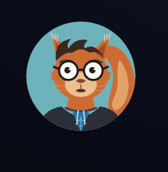
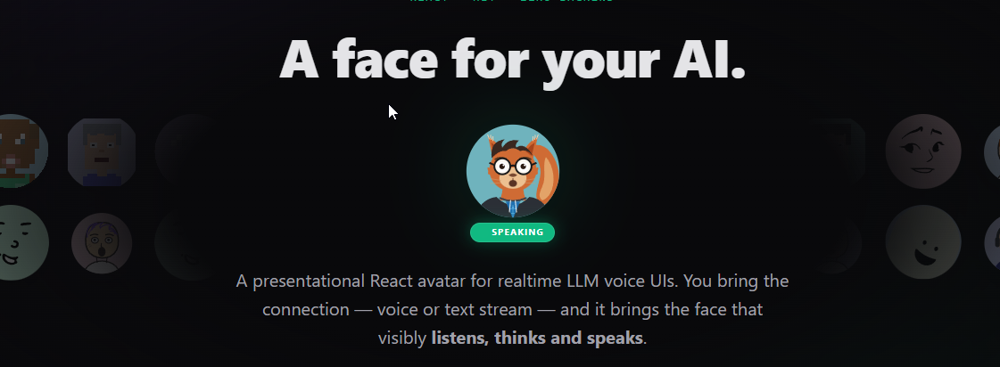

<p align="center">
  <a href="https://react-ai-avatar.vercel.app/">
    
  </a>
</p>

<h1 align="center">react-ai-avatar</h1>

<p align="center">
  <strong>A face for your AI.</strong><br/>
  A presentational React avatar for realtime LLM voice &amp; text UIs — you bring the connection,<br/>
  it brings the face that visibly <strong>listens, thinks and speaks</strong>.
</p>

<p align="center">
  <a href="https://github.com/aralde/react-ai-avatar/actions/workflows/ci.yml"></a>
  <a href="https://www.npmjs.com/package/react-ai-avatar"></a>
  <a href="https://www.npmjs.com/package/react-ai-avatar"></a>
  <a href="#entry-points-and-bundle-size"></a>
  
  
  <a href="./LICENSE"></a>
</p>

<p align="center">
  <a href="https://www.npmjs.com/package/react-ai-avatar"><b>npm</b></a> &nbsp;·&nbsp;
  <a href="https://react-ai-avatar.vercel.app/#/docs"><b>Documentation</b></a> &nbsp;·&nbsp;
  <a href="https://react-ai-avatar.vercel.app/"><b>Live demos</b></a> &nbsp;·&nbsp;
  <a href="#quickstart"><b>Quickstart</b></a>
</p>

---

**react-ai-avatar** handles exactly one step of your voice/chat pipeline: turning audio amplitude and conversation-state changes into a face that visibly reacts. It is **completely LLM-agnostic** — it doesn't know about Gemini, OpenAI or ElevenLabs. You pass two live things — a `state` and (optionally) a WebAudio `AnalyserNode` — and it does the rest. No runtime dependencies besides React. Your host app keeps the microphone, the WebSocket and the AI provider; **none of those dependencies enter your bundle**. One thing, done well, embeddable in a few lines, no backend, MIT.

```tsx
import { RealtimeAvatar } from 'react-ai-avatar';
import 'react-ai-avatar/style.css';

// The whole thing, minimally. Every prop has a sensible default.
<RealtimeAvatar state="speaking" />
```

<p align="center">
  
</p>

## Quickstart

```bash
npm install react-ai-avatar
```

`react` and `react-dom` are the only required peer dependencies. The one prop that matters is `state` — you resolve it in your app, the avatar never infers it:

```tsx
import { RealtimeAvatar } from 'react-ai-avatar';
import 'react-ai-avatar/style.css';

export default function App() {
  // You resolve this in your app (Gemini, OpenAI Realtime, WebRTC, anything)
  const aiState = 'speaking'; // 'idle' | 'listening' | 'thinking' | 'speaking' | 'working'

  return <RealtimeAvatar state={aiState} />;
}
```

With no `analyser`, `speaking` falls back to a synthetic speech-like mouth — great for getting something on screen before the audio pipeline exists. Pass an `AnalyserNode` to make the mouth react to real audio (see [Driving the mouth](#driving-the-mouth)). Every default is overridable:

```tsx
<RealtimeAvatar
  state={aiState}
  analyser={analyser}                 // AnalyserNode | null — real audio-reactive mouth
  size={300}                          // px or any CSS length ('100%'); default 280
  variant="geometric"                 // 'geometric' | 'memoji' | 'pixelart' | 'doodle' | 'orb' | 'dicebear' | 'vrm' | 'glb' | 'byos'
  customization={{ skinColor: '#f5c7a9', glasses: true }}  // flat presets only; just the keys you change
  stateColors={{ idle: '#4b5563', listening: '#3b82f6', thinking: '#8b5cf6', speaking: '#10b981', working: '#f59e0b' }}
/>
```

For the optional 3D (VRM) variant, also install `three @react-three/fiber @react-three/drei @pixiv/three-vrm`; for `glb`, the same minus `@pixiv/three-vrm`; for `dicebear`, `@dicebear/core @dicebear/collection`. All are **optional** peer dependencies, lazy-loaded only if you use that variant.

### Entry points and bundle size

The main entry is the core: `RealtimeAvatar`, `VideoAvatar`, the orb, the four flat presets, the `#rra-*` runtime and the mouth drivers. The rest lives in subpaths, so you only ship what you import:

| Import from | What's there |
|---|---|
| `react-ai-avatar` | the core (above) |
| `react-ai-avatar/characters` | `SquirrelAvatar`, `CoderAvatar`, `PortraitAvatar` |
| `react-ai-avatar/dicebear` | `DiceBearAvatar`, `DiceBearThumb` and the style catalog |
| `react-ai-avatar/3d` | `VrmAvatar`, `GlbArkitAvatar` (also at `react-ai-avatar/vrm`) |

What each import costs your bundle, tree-shaken, minified and gzipped, with React and the optional peers left out ([`scripts/size.mjs`](scripts/size.mjs), checked in CI against the budgets):

<!-- size:start -->
| Import | gzip | budget |
|---|---:|---:|
| `RealtimeAvatar` (core) | 17.0 kB | 18 kB |
| `OrbAvatar` | 1.9 kB | 3 kB |
| `VideoAvatar` | 5.9 kB | 7 kB |
| `createSpeechActivity` only | 0.4 kB | 1 kB |
| `react-ai-avatar/characters` (Squirrel) | 2.9 kB | 4 kB |
| `react-ai-avatar/characters` (Portrait) | 39.8 kB | 42 kB |
| `react-ai-avatar/dicebear` | 3.7 kB | 5 kB |
| `react-ai-avatar/3d` | 3.7 kB | 5 kB |
<!-- size:end -->

`variant="dicebear"`, `"vrm"` and `"glb"` load their renderer as a separate chunk only when they render, so they don't count toward the core.

> It works? ⭐ [**Star the repo**](https://github.com/aralde/react-ai-avatar) — takes 2 seconds and helps other React devs find it.

## Table of contents

- [Entry points and bundle size](#entry-points-and-bundle-size)
- [Philosophy](#philosophy)
- [Features](#features)
- [The avatar catalog](#the-avatar-catalog)
- [Driving the mouth](#driving-the-mouth)
  - [Audio: getting an `AnalyserNode`](#audio-getting-an-analysernode)
  - [Text-streaming LLMs (no audio)](#text-streaming-llms-no-audio)
- [The orb (`orb`)](#the-orb-orb)
- [Bring your own SVG (`byos`)](#bring-your-own-svg-byos)
- [3D avatars (VRM and GLB)](#3d-avatars-vrm-and-glb)
- [DiceBear avatars (`dicebear`)](#dicebear-avatars-dicebear)
- [Video avatars (`VideoAvatar`)](#video-avatars-videoavatar)
- [API reference](#api-reference)
- [Building blocks](#building-blocks)
- [Positioning](#positioning)
- [Migrating from 0.6](#migrating-from-06)
- [Migrating from 0.5](#migrating-from-05)
- [Examples](#examples)
- [Contributing](#contributing)
- [License](#license)

## Philosophy

One thing, done well, embeddable in a few lines, no backend, MIT. The library handles exactly one step of your voice pipeline: turning audio amplitude + state changes into a face that visibly **listens, thinks and speaks**. Your host app keeps the microphone, the WebSocket and the AI provider — none of those dependencies enter your bundle.

## Features

- 👄 **Audio-reactive mouth** — analyzes amplitude and frequency bands in real time. This is deliberately *not* phoneme-perfect "lip-sync": an `AnalyserNode` gives energy, not phonemes, and for flat avatars amplitude is what looks right.
- 🦺 **Graceful degradation** — `analyser={null}` while `state="speaking"`? The mouth animates with a synthetic speech-like pattern instead of freezing. Perfect for demos and non-WebRTC apps.
- ⌨️ **Text-streaming LLMs too** — no audio? Drive the mouth from *token cadence* with `createSpeechActivity()`. A text-only assistant (OpenAI-style `/chat/completions` or `/responses` with `stream: true`) gets a face that visibly tracks the stream — busy while tokens arrive, settling on pauses.
- 🧠 **A visible `thinking` state** — pulsing thought bubble + upward gaze. Your users *see* the LLM thinking, not just a color change.
- 🛠️ **A `working` state for tool use** — the fifth state, for agentic UIs. While the LLM runs a tool, the face goes amber and the state pill reads `Working: {tool}` (pass the tool name via the `tool` prop). Your users see *which* tool is running, not just a spinner.
- 🔮 **An orb, too** — `variant="orb"` (or `<OrbAvatar />`): the glossy sphere voice assistants use instead of a face. It breathes, swirls while thinking, spins a ring while working and swells with the voice.
- 🎨 **Own-design avatar catalog** — `geometric`, `memoji`, `pixelart`, `doodle`: four MIT, CC0-safe SVG presets. No third-party assets, no attribution headaches.
- 🎲 **DiceBear avatars (`dicebear`)** — generate deterministic [DiceBear](https://www.dicebear.com) avatars client-side, from a curated **CC0-only** style set (still no attribution). Animated with an audio-reactive bounce.
- 🔌 **Bring your own SVG (`byos`)** — any SVG implementing the small layer contract gets the full animation runtime for free. Your avatar, your license.
- ♿ **Production quality** — SSR-safe (Next.js friendly), honors `prefers-reduced-motion`, announces state changes via `aria-live`.
- 🎬 **Video avatars (`VideoAvatar`)** — bring your own footage: one short looping clip per state (generated with a text-to-video model or recorded), crossfaded on state changes, with speech-gated talking, idle variations and flicker-free tool bursts. Photoreal, still 100% client-side.
- 🧊 **Optional 3D (VRM/GLB)** — `variant="vrm"` / `variant="glb"` render VRoid/VRM and ARKit-rigged glTF models with visemes and gaze tracking. The three.js stack is an *optional* peer dependency, lazy-loaded only if you use it.

## The avatar catalog

| variant | style | notes |
|---|---|---|
| `geometric` | minimal flat geometry | the default; canonical layer-contract example |
| `memoji` | soft volumetric head | radial gradients, glossy eyes, blush |
| `pixelart` | retro 32×32 grid | mouth and pupils move in whole pixels |
| `doodle` | hand-drawn ink sketch | wobbly strokes, sketched thought bubble |
| `orb` | glossy sphere | the voice-assistant look; no face, same states and drivers |
| `dicebear` | [DiceBear](https://www.dicebear.com) styles | optional, lazy-loaded; curated CC0 set; pass `dicebearCollection` / `dicebearSeed` |
| `vrm` | 3D VRoid/VRM model | optional, lazy-loaded; pass `vrmUrl` |
| `glb` | 3D glTF + ARKit blendshapes | optional, lazy-loaded; pass `glbUrl`. Works with [Microsoft Rocketbox](https://github.com/microsoft/Microsoft-Rocketbox) (MIT), Ready Player Me, or any `.glb` exposing the 52 ARKit morph targets |
| `byos` | **your** SVG | pass it as children (the variant is then implied); see the layer contract |

All built-in presets are original designs licensed MIT — nothing inside this package requires attribution.

Want a photoreal face instead of a drawn one? That's not a `variant` but its own component: see [Video avatars](#video-avatars-videoavatar).

## Driving the mouth

The mouth has three possible drivers, in precedence order: an explicit `speechActivity` source, then `streamingText`, then the audio `analyser`. Pick whichever matches your pipeline — voice apps use the analyser, text-only LLMs use the streaming-text paths.

### Audio: getting an `AnalyserNode`

The standard recipe for base64 PCM streams (what Gemini Live / OpenAI Realtime return):

```ts
const audioCtx = new AudioContext({ sampleRate: 24000 });
const analyser = audioCtx.createAnalyser();
analyser.fftSize = 256;
analyser.connect(audioCtx.destination);

function playAudioChunk(pcmData: Float32Array) {
  const buffer = audioCtx.createBuffer(1, pcmData.length, 24000);
  buffer.getChannelData(0).set(pcmData);
  const source = audioCtx.createBufferSource();
  source.buffer = buffer;
  source.connect(analyser); // <- the analyser you pass to <RealtimeAvatar />
  source.start();
}
```

### Text-streaming LLMs (no audio)

Not every assistant speaks. For a text-only LLM that streams tokens — OpenAI-style `/chat/completions` or `/responses` with `stream: true`, or local servers like Ollama / LM Studio / vLLM — there's no `AnalyserNode` to read. Instead, drive the mouth from **token cadence**: the rhythm of arriving text becomes the same 0..1 energy signal the audio path produces. The mouth is busy while the model emits text and settles shut on pauses or when the stream ends. The library still never fetches anything — you own the stream, it owns the face.

There are two ways to feed it, matching the two ways React apps consume streams.

#### Declarative — `streamingText` (the easy path)

If you use a streaming chat hook — the [Vercel AI SDK](https://sdk.vercel.ai)'s `useChat` is the de-facto standard — you never see raw chunks: you get the **accumulated** assistant message (it grows each render) plus a `status`. Both map straight onto the avatar. Pass the text, the avatar diffs its growth internally and drives the mouth. No refs, no reader loop:

```tsx
import { useChat } from '@ai-sdk/react';
import { RealtimeAvatar } from 'react-ai-avatar';
import 'react-ai-avatar/style.css';

function ChatAvatar() {
  const { messages, status } = useChat();
  const last = messages.at(-1);

  return (
    <RealtimeAvatar
      // status: 'submitted' (awaiting first token) | 'streaming' | 'ready'
      state={status === 'submitted' ? 'thinking' : status === 'streaming' ? 'speaking' : 'idle'}
      streamingText={last?.role === 'assistant' ? last.text : ''}
    />
  );
}
```

That's the whole integration. `streamingText` takes precedence over `analyser`; the ambient glow reacts to it too. Works with every variant — flat presets, DiceBear, VRM and GLB.

#### Imperative — `createSpeechActivity()` (you own the reader loop)

Hand-rolling `fetch` or driving the OpenAI SDK's `for await` yourself? Then you *do* have the raw chunks — feed their cadence directly with a `SpeechActivitySource`:

```tsx
import { RealtimeAvatar, createSpeechActivity } from 'react-ai-avatar';
import 'react-ai-avatar/style.css';
import { useRef, useState } from 'react';

function TextAvatar() {
  const speech = useRef(createSpeechActivity()).current;
  const [state, setState] = useState<'idle' | 'thinking' | 'speaking'>('idle');
  const [subtitle, setSubtitle] = useState('');

  async function ask(prompt: string) {
    setState('thinking');
    speech.reset();
    const res = await fetch('/api/chat', {
      method: 'POST',
      headers: { 'Content-Type': 'application/json' },
      body: JSON.stringify({ messages: [{ role: 'user', content: prompt }] }),
    });
    const reader = res.body!.getReader();
    const decoder = new TextDecoder();
    let text = '';
    for (;;) {
      const { done, value } = await reader.read();
      if (done) break;
      const chunk = decoder.decode(value); // your SSE/delta parsing here
      text += chunk;
      speech.push(chunk);   // <- feed token cadence to the mouth
      setSubtitle(text);
      setState('speaking');
    }
    speech.end();
    setState('idle');
  }

  return <RealtimeAvatar state={state} speechActivity={speech} subtitle={subtitle} />;
}
```

`createSpeechActivity(options?)` accepts `chargePerChar`, `decayMs` and `maxChargePerPush` to tune how wide / how fast the mouth reacts. The returned source has `push(chunk)`, `end()`, `reset()` (drop energy on an interrupted turn) and `sample()`. When `speechActivity` is provided it takes precedence over both `streamingText` and `analyser`. (`streamingText` is just this, with the diffing done for you — under the hood it's the exported `useStreamingTextActivity` hook.)

> [`examples/03-streaming-text-imperative.tsx`](examples/03-streaming-text-imperative.tsx) shows this end-to-end against an OpenAI-compatible endpoint. The browser only ever talks to your own `/api/chat`; a tiny reference relay that proxies to the provider (so the key never reaches the client) lives in [`examples/server/proxy.ts`](examples/server/proxy.ts).

## The orb (`orb`)

Many voice apps show an animated sphere instead of a face. Same props, same drivers, same overlays:

```tsx
<RealtimeAvatar variant="orb" state={aiState} analyser={analyser} />
```

Idle, it breathes slowly; listening, it reacts to the audio; thinking, it swirls faster; working, a ring spins around it; speaking, it swells with the voice. The state color tints it (`stateColors`). Under `prefers-reduced-motion` it holds still and only changes color. Want just the sphere, without the pill and bubbles? Use `<OrbAvatar state={aiState} analyser={analyser} />`.

## Bring your own SVG (`byos`)

Any SVG exposing these stable hooks is animated by the runtime — same blink, gaze, mouth and thinking behavior as the built-in presets:

| hook | part | the runtime drives |
|---|---|---|
| `#rra-ring` | state ring | `stroke` = `stateColors[state]` |
| `#rra-mouth` | mouth | ellipse: `ry`/`rx` · rect: `height` |
| `.rra-pupil` (×2) | pupils | circle: `cx`/`cy` · rect: `x`/`y` (mouse tracking, thinking gaze) |
| `.rra-lid` (×2) | eyelids | `height` (blink; 0 = open) |
| `#rra-think` | thought bubble | `opacity` + dots pulsing while `thinking` |

Optional data attributes: `data-base-x`/`data-base-y` (pupil rest position), `data-max-height` (closed lid height), `data-quantize` (snap motion to a grid — that's how the pixel-art preset stays chunky).

```tsx
<RealtimeAvatar state={aiState} analyser={analyser}>
  <MyOwnSvgAvatar /> {/* exposes the #rra-* hooks; its license is your business */}
</RealtimeAvatar>
```

Passing children implies `variant="byos"`. Pass `state` once, to `RealtimeAvatar`: a face that needs it for its own poses reads it with `useAvatarState()`, and the shipped characters already do:

```tsx
import { SquirrelAvatar } from 'react-ai-avatar/characters';

<RealtimeAvatar state={aiState}>
  <SquirrelAvatar poses /> {/* follows aiState: hand on chin while thinking, etc. */}
</RealtimeAvatar>
```

```tsx
import { useAvatarState } from 'react-ai-avatar';

function MyOwnSvgAvatar() {
  const state = useAvatarState(); // the enclosing avatar's state
  return <svg viewBox="0 0 200 200">{/* … #rra-* hooks, plus a prop for 'working' */}</svg>;
}
```

## 3D avatars (VRM and GLB)

Both 3D variants share the same mouth engine as the flat presets, so the model talks, blinks and follows the cursor. The three.js stack is an **optional** peer dependency, lazy-loaded only when one of these variants renders — it never enters your bundle otherwise.

**`vrm`** — render VRoid/VRM models with visemes and gaze tracking:

```bash
npm install three @react-three/fiber @react-three/drei @pixiv/three-vrm
```

```tsx
<RealtimeAvatar state={aiState} analyser={analyser} variant="vrm" vrmUrl="/models/avatar.vrm" />
```

**`glb`** — render any `.glb` that exposes the **52 [ARKit blendshapes](https://arkit-face-blendshapes.com/)** (the standard `jawOpen`, `mouthFunnel`, `eyeBlinkLeft`, … morph targets). Same deal as `vrm`, minus `@pixiv/three-vrm`:

```bash
npm install three @react-three/fiber @react-three/drei
```

```tsx
<RealtimeAvatar state={aiState} analyser={analyser} variant="glb" glbUrl="/models/rocketbox.glb" />
```

To render a 3D model outside `RealtimeAvatar`, import `VrmAvatar` or `GlbArkitAvatar` from `react-ai-avatar/3d`.

**Recommended example asset — Microsoft Rocketbox (MIT).** [Rocketbox](https://github.com/microsoft/Microsoft-Rocketbox) ships 115 rigged avatars with an ARKit-compatible blendshape variant, under the **MIT license** — the cleanest fit for this library's no-attribution-headaches philosophy. Rocketbox distributes `.fbx`, so convert one avatar to `.glb` once (offline, via [FBX2GLTF](https://github.com/facebookincubator/FBX2glTF) or Blender's glTF 2.0 export, keeping the blendshapes) and drop it in `public/models/`. Keep the MIT notice alongside it. [Ready Player Me](https://docs.readyplayer.me/ready-player-me/api-reference/avatars/morph-targets/apple-arkit) avatars (`?morphTargets=ARKit`) also work out of the box.

## DiceBear avatars (`dicebear`)

Generate [DiceBear](https://www.dicebear.com) avatars client-side — deterministic per `seed`, no network call. The packages are **optional** peer dependencies, lazy-loaded only when this variant renders:

```bash
npm install @dicebear/core @dicebear/collection
```

```tsx
<RealtimeAvatar
  state={aiState}
  analyser={analyser}
  variant="dicebear"
  dicebearCollection="open-peeps" // curated CC0 style id
  dicebearSeed="ada-lovelace"     // same seed + style => same face
/>
```

**Licensing:** DiceBear ships ~30 styles under mixed licenses. This library's catalog (`DICEBEAR_STYLES`) is curated to **CC0 1.0** styles that have a face — `pixel-art`(+`-neutral`), `lorelei`(+`-neutral`), `notionists`(+`-neutral`), `open-peeps`, `thumbs` — so it keeps the same no-attribution promise as the built-in presets. You *can* pass any other DiceBear style id to `dicebearCollection`, but then its license (e.g. CC BY 4.0 for `adventurer`, or "free for personal and commercial use" for `bottts`) is your responsibility — same deal as `byos`.

**Animation:** DiceBear SVGs have no `#rra-*` hooks, but their *option API* lets us pick which mouth/eyes variant to render. So every curated style actually **talks**: it pre-generates a few frames of the same avatar (same seed ⇒ identical hair/skin/etc.) with closed / mid / open mouths — plus a blink frame where the style allows — and swaps which frame is shown per audio frame, with a subtle bounce on top. Real articulation via the supported API, no fragile path hacks. The per-style variant choices live in the exported `DICEBEAR_RIGS` map. (A non-rigged style id you pass yourself — e.g. a faceless abstract DiceBear style — falls back to a pure audio-reactive bounce.) State color and the thinking bubble still come from the surrounding `<RealtimeAvatar />` chrome. For the standalone `DiceBearAvatar` / `DiceBearThumb` and the catalog helpers, import from `react-ai-avatar/dicebear`.

## Video avatars (`VideoAvatar`)

Instead of drawing a face, play footage: one short looping clip per state, crossfaded when `state` changes. The package ships **no** footage — you pass the URLs.

```tsx
import { VideoAvatar, type VideoClips, type IdleVariation } from 'react-ai-avatar';

const clip = (name: string) => ({ webm: `/clips/${name}.webm`, mp4: `/clips/${name}.mp4` });

// Module constants (or useMemo): a new array identity restarts the idle timer.
const CLIPS: VideoClips = {
  idle: clip('idle'),           // required
  listening: clip('listening'), // every other state is optional:
  thinking: clip('thinking'),   //   working → thinking → idle, the rest → idle
  working: clip('working'),
  speaking: clip('speaking'),
};
const IDLE_VARIATIONS: IdleVariation[] = [
  { clip: clip('idle-stretch'), cooldownMs: 60_000 },
  { clip: clip('idle-coffee'), afterIdleMs: 90_000, cooldownMs: 300_000 },
];

<VideoAvatar
  clips={CLIPS}
  state={aiState}
  speechActivity={speech}       // or analyser={analyser}
  idleVariations={IDLE_VARIATIONS}
  poster="/clips/poster.jpg"
  size={320}
  style={{ borderRadius: '50%' }}
/>
```

What it does for you:

- **Speech-gated talking.** With `speechActivity` or `analyser`, the speaking clip shows only while there's speech energy; after ~0.7 s of silence it falls back to idle and resumes when speech does. Commas and word gaps don't trigger it, only real pauses.
- **Idle variations.** One-shot clips played now and then while idle (every `idleVariationIntervalMs`, default 15–30 s), each with its own `afterIdleMs` (e.g. the coffee only after a long wait) and `cooldownMs`. Any state change cancels them.
- **No flicker on tool bursts.** An agent loop flips `thinking ↔ working` on every tool call. A clip stays on screen at least `minHoldMs` (default 1.2 s), and swaps between those two wait until the new state has held for `busySettleMs` (default 1 s) — a burst of short tools keeps the face still; only a long-running one shows `working`.
- **Seamless cuts.** Clips crossfade (`crossfadeMs`, default 350) and resume where they paused instead of restarting.
- `prefers-reduced-motion` holds a still frame and skips idle variations.
- **The same overlays as `RealtimeAvatar`**: the state pill (`Working: {tool}`), thought and emoji bubbles, subtitles and the reactive glow, with the same props and defaults. Turn them off one by one (`showStatePill={false}`, …) for a bare video.

### Making the clips (step by step, with Google Flow)

The whole technique hinges on a **hub frame**: one neutral still of your character (relaxed face, mouth closed, looking into the camera) that every clip starts *and* ends on, so loops close and cuts don't jump. Any text-to-video tool with first/last-frame conditioning works; this walkthrough uses [Google Flow](https://labs.google/flow) (Veo), which has a small free daily allowance.

1. **Make the hub frame.** In Flow, pick **Image** and generate a portrait — e.g. *"Photorealistic head-and-shoulders portrait of [your character], centered, looking into the camera, relaxed face, mouth closed, [setting], soft natural light"* — and download it. Or use a photo you have the rights to (and, if it's a real person, their consent).
2. **Set up a clip.** Pick **Video → Frames**, aspect **16:9**, model **Veo 3.1 Lite** (the cheapest; plenty for 512 px), **x1**. Put the hub frame in **both** slots — first *and* last frame. That's what makes every clip return to the same pose.
3. **Generate the five state clips**, one prompt each (below). Download each MP4.
4. **Prepare them** with [`scripts/prepare-video-clips.ts`](scripts/prepare-video-clips.ts) (needs `ffmpeg`): square crop, scale, strip audio, encode WebM + MP4. `--mode loop` (default) makes a *boomerang* — the range forward then reversed — so even a clip that drifts loops without a jump; `--mode once` is for idle variations. `--from`/`--to` keep only the usable part.

```bash
node --experimental-strip-types scripts/prepare-video-clips.ts raw/idle.mp4 --name idle --out public/clips --poster
node --experimental-strip-types scripts/prepare-video-clips.ts raw/coffee.mp4 --name idle-coffee --mode once --out public/clips
```

<details>
<summary><strong>The five prompts</strong> (one per state — the hub frame carries the character, so they stay short)</summary>

**idle**
```
Cinematic living portrait of the person in the reference frame, like a photograph that gently comes alive. Same framing and lighting, static tripod camera, no cuts. They sit peacefully: relaxed closed lips, a faint calm smile, slow steady breathing, two slow blinks, a barely perceptible head sway. Ends in exactly the starting pose. Audio: quiet room ambience and soft birdsong. No text, no music.
```

**listening**
```
Cinematic living portrait of the person in the reference frame. Same framing and lighting, static tripod camera, no cuts. They are absorbed in what someone off-screen is telling them: relaxed closed lips, eyebrows slowly rising with curiosity, a slight lean forward, one slow nod in the middle, natural blinks, then they settle back. Ends in exactly the starting pose. Audio: quiet room ambience. No text, no music.
```

**thinking**
```
Cinematic living portrait of the person in the reference frame. Same framing and lighting, static tripod camera, no cuts. They are thinking something over: the eyes drift up and to the side, a slight squint, the head tilts a little, lips pressed into a thoughtful "hmm", then the gaze returns to the camera. Ends in exactly the starting pose. Audio: quiet room ambience. No text, no music.
```

**working**
```
Cinematic living portrait of the person in the reference frame. Same framing and lighting, static tripod camera, no cuts. They are focused on a laptop just below the camera: gaze lowered, eyes moving in small reading motions across the screen, brows lightly concentrated, a soft screen glow on the face. In the last second they look back up. Ends in exactly the starting pose. Audio: quiet keyboard taps. No text, no music.
```

**speaking**
```
The person in the reference frame talks warmly to the camera, explaining something in a friendly way. Same framing and lighting, static tripod camera, no cuts. Clear, natural mouth movement, small head movements and eyebrow emphasis, natural blinks. Starts and ends with closed lips in the starting pose. No text, no music.
```

**Optional idle variations** (generate the same way, prepare with `--mode once`): *"…they bring a coffee cup up, take a slow sip with eyes half-closed, and put it down"*; *"…they rest their chin on one hand for a moment, glancing out of the window"*.

</details>

**Why the prompts read like that:** video models love to make a person facing the camera start *talking*, and negations ("does not speak", "no dialogue") tend to backfire by putting speech in the prompt. So the silent ones describe what the face *does*, frame it as a still scene ("living portrait"), and give the audio track something else to be about. If a clip still talks for part of it, keep it and trim to the silent stretch with `--from`/`--to`.

**Limits, honestly:** the mouth isn't synced to the words — speaking is gated on/off by speech energy, not phoneme-accurate. Speech detection runs on `requestAnimationFrame`, so it pauses in background tabs. Clips must be muted to autoplay (they are). Seven 512 px clips run about 3 MB as WebM; they're loaded up front (`preload="auto"`) so switches are instant. See [`examples/12-video-avatar.tsx`](examples/12-video-avatar.tsx).

## API reference

### `<RealtimeAvatar />`

- `state` (`'idle' | 'listening' | 'thinking' | 'speaking' | 'working'`) — default `'idle'`. You resolve it; it is never inferred. `working` is the tool-use state for agentic UIs (amber). Faces passed as children inherit it.
- `tool` (`string`) — optional. The name of the tool currently running. While `state="working"`, the state pill reads `Working: {tool}` instead of the generic label.
- `analyser` (`AnalyserNode | null`) — optional. Drives the mouth from audio. Omitted or `null`, speaking falls back to the synthetic pattern.
- `streamingText` (`string`) — optional. Declarative mouth driver: pass the accumulated assistant text (e.g. from `useChat`) and the avatar diffs its growth to drive the mouth. Takes precedence over `analyser`. See [Text-streaming LLMs](#text-streaming-llms-no-audio).
- `speechActivity` (`SpeechActivitySource`) — optional. Imperative token-rate mouth driver, from `createSpeechActivity()`. Takes precedence over both `streamingText` and `analyser` when set.
- `size` (`number | string`) — px as a number, or any CSS length (`'100%'`, `'12rem'`); the box stays square. Default `280`.
- `variant` — see catalog above. Default `'byos'` when you pass `children`, else `'geometric'`.
- `children` — your face: an SVG on the `#rra-*` contract or a character from `react-ai-avatar/characters`.
- `label` (`string`) — accessible name, default `'Avatar'`; announced as `"{label} ({state label})"`.
- `vrmUrl` (`string`) — CORS-enabled `.vrm` URL, for `variant="vrm"`.
- `glbUrl` (`string`) — CORS-enabled `.glb` URL with ARKit blendshapes, for `variant="glb"`.
- `dicebearCollection` (`string`) — DiceBear style id (curated CC0 set), for `variant="dicebear"`.
- `dicebearSeed` (`string`) — deterministic DiceBear seed, for `variant="dicebear"`.
- `subtitle` / `thought` (`string`) — optional movie-style caption and a thought bubble. Pass raw text or markdown: both are flattened to spoken prose and rolled to a trailing window internally, so a long streamed reply never overflows or shows raw `**`/tables. For a long assistant reply, keep the full markdown in your chat transcript and pass the same text here for the short live caption.
- `thinkingEmojis` (`boolean | string[]`) — optional emulated "thinking" reel. While `state="thinking"`, a bubble in the avatar's top-right corner cross-fades through a set of emojis instead of showing raw reasoning: pass `true` for the default reasoning/study/web set (`🤔 💭 📚 🔍 🌐 💡 🧠 📝 ⚙️`) or your own array. It's anchored **inside** the avatar's own `size × size` box (not floating outside), so it never grows the component's footprint or collides with your surrounding layout. When active it takes the bubble slot, so the text `thought` overlay stands down — surface the real reasoning elsewhere (e.g. a Claude-Code-style panel in your chat). `thinkingEmojiInterval` (`number`, ms, default `900`) tunes the cadence; `thinkingEmojiSize` (`number`, px, default ~28% of `size`) tunes the bubble diameter. Honors `prefers-reduced-motion` (holds one emoji). See [`examples/09-thinking-emoji-reel.tsx`](examples/09-thinking-emoji-reel.tsx).
- `showGlow` / `showStatePill` / `showThought` / `showSubtitle` (`boolean`) — HUD satellites, each `true` by default. Set any to `false` to hide it individually: the reactive glow, the state pill, the thought bubble, and the subtitle respectively. The built-in subtitle/thought float `absolute` around the face (needs open canvas); inside a constrained card, set `showSubtitle={false}` / `showThought={false}` and render `<AvatarCaption>` / `<AvatarThought>` in your own layout slot instead.
- `maxMouthOpening`, `mouseTrackingIntensity`, `blinkIntervalMin/Max`, `blinkDuration` — animation tuning.
- `stateColors`, `stateLabels` — theming; labels are announced via `aria-live` and used in the accessible name, so localize them there. Both cover all five states including `working`.
- `customization` — preset colors and accessories (skin, hair, clothing, glasses, headphones…).

### `<VideoAvatar />`

- `clips` (`VideoClips`) — required. A clip per state; `idle` is required, the rest fall back (`working` → `thinking` → `idle`, others → `idle`). Each clip is a URL or `{ webm, mp4 }` (WebM is offered first).
- **Everything `RealtimeAvatar` has around the face, with the same names and defaults**: `state`, `size`, `label`, `tool`, `subtitle`, `thought`, `thinkingEmojis` (+ `Interval` / `Size`), `showGlow` / `showStatePill` / `showThought` / `showSubtitle`, `stateColors`, `stateLabels`, `className`, `style`.
- `speechActivity` / `streamingText` / `analyser` — the same three mouth drivers, in the same precedence. Here they gate the speaking clip; without any, `speaking` simply plays its clip.
- `idleVariations` (`IdleVariation[]`) — one-shot clips `{ clip, afterIdleMs?, cooldownMs? }` played now and then while idle. Keep the array stable.
- `idleVariationIntervalMs` (`[min, max]`, default `[15000, 30000]`) — random wait between variations.
- `minHoldMs` (default `1200`) / `busySettleMs` (default `1000`) — anti-flicker: minimum time on screen, and how long `thinking`/`working` must hold before swapping between them.
- `crossfadeMs` (default `350`), `poster`. `size` defaults to `'100%'` here (a video usually fills its slot) instead of `280`.

### Building blocks

Everything the runtime uses is exported, so you can compose your own:

- `ContractAvatar` — wraps any contract-compliant SVG with the runtime.
- `useAvatarRuntime(containerRef, options)` — the animation runtime itself.
- `createMouthEngine(source)` / `useAudioMouth(...)` — the source→mouth analysis (amplitude + A/E/O shapes), procedural fallback included. `source` is an `AnalyserNode`, a `SpeechActivitySource`, or `null`.
- `createSpeechActivity(options?)` — the token-rate mouth driver for text streams (`push` / `end` / `reset` / `sample`).
- `useStreamingTextActivity(text)` — declarative wrapper: diffs accumulated streaming text into a `SpeechActivitySource` for you (what the `streamingText` prop uses).
- `useReducedMotion()` — SSR-safe `prefers-reduced-motion` hook.
- `GeometricAvatar`, `MemojiAvatar`, `PixelArtAvatar`, `DoodleAvatar` — the raw presets.
- `OrbAvatar` — the orb without the overlays.
- `useAvatarState(own?)` / `AvatarStateContext` — the enclosing avatar's state, for faces passed as children.
- `DEFAULT_STATE_COLORS` / `DEFAULT_STATE_LABELS` — the fallbacks behind `stateColors` / `stateLabels`.

From `react-ai-avatar/characters`:

- `SquirrelAvatar` — a full branded character (red-squirrel dev face) built on the `#rra-*` contract; the worked `byos` example, shipped so the demos render it from one source. See [`examples/08-character-avatar-squirrel.tsx`](examples/08-character-avatar-squirrel.tsx). Inside `RealtimeAvatar` it follows the avatar's `state`; standalone, pass `state` yourself. Opt in to its per-state poses (hand-on-chin while thinking; a reading/soldering scene while working) with `poses` — **off by default**, so it stays as calm as the other presets unless you ask.
- `CoderAvatar` — a second branded character on the same contract: a young developer (knit beanie, over-ear headphones, round glasses, hoodie + circuit tee). Same API as `SquirrelAvatar`: `poses` opts into hand-on-chin while thinking and a typing/reading scene while working. See [`examples/10-character-avatar-developer.tsx`](examples/10-character-avatar-developer.tsx).
- `PortraitAvatar` — the "puppet" technique: a fixed illustration (the author's portrait) embedded untouched, with only the moving parts (lids, pupils, mouth, thought bubble) drawn on top as colour-matched vector layers. The talking mouth closes in pauses and shows teeth as it opens, the eyes narrow toward the bubble while thinking, and the monitors behind run scrolling terminal output. Its illustration is inlined, so at ~40 kB gzip it's the heaviest export in the package. Same API as the other characters: `poses` opts into a coffee break while idle and a back view facing the monitors while working. See [`examples/11-portrait-avatar.tsx`](examples/11-portrait-avatar.tsx).

From the main entry again:

- `AudioVisualizer` — Siri-style waveform telemetry strip.
- `AvatarCaption` / `AvatarThought` — host-placed caption + thought widgets. In-flow (not `absolute`), so they fit your own layout slot without overflow; both flatten markdown to spoken prose and roll a trailing window.
- `ThoughtEmojiBubble` — the standalone emoji reel behind `thinkingEmojis` (cross-fades through `emojis`, honors reduced motion). Drop it into your own slot to run it independent of `state`. `DEFAULT_THINKING_EMOJIS` is the exported default set.
- `toPlainText(md)` / `tailWindow(text, { maxChars })` — the pure text helpers behind those widgets, for building your own caption.

## Positioning

The closest reference is [TalkingHead](https://github.com/met4citizen/TalkingHead) (3D, realistic lip-sync, Ready Player Me/Mixamo rigs). This library makes the opposite bet:

| | TalkingHead & co. | react-ai-avatar |
|---|---|---|
| Star of the show | the realistic human avatar | the LLM's speech + **state** flow |
| Avatar | 3D full-body rigged | flat SVG, minimal (3D optional, not the focus) |
| Technical focus | lip-sync fidelity | state + audio reactivity, simplicity |
| Makes visible | the voice | the *thinking* |
| Setup | avatar platform + Blender + rig | `npm i` + one component |

For a photoreal face, `VideoAvatar` sits between a drawn face and the neural talking-head services (HeyGen, D-ID, Tavus, Simli). Those render real lip-sync server-side per conversation, are paid per minute, and add a streaming backend; `VideoAvatar` plays pre-made clips entirely in the browser, free and backend-less, at the cost of gated rather than synced lips.

## Migrating from 0.6

0.7 changes nothing at runtime; it makes mistakes visible. What changes for you:

- **Props are typed per `variant`.** TypeScript now rejects a prop the variant ignores. The usual fixes: drop `maxMouthOpening` / `mouseTrackingIntensity` / blink timings from `variant="orb"`; drop `variant="byos"` or a preset `variant` when you pass children (children imply `byos`); keep `customization` on the flat presets only; always pass `vrmUrl` / `glbUrl` with `vrm` / `glb`. If you switch variants at runtime, give the variant with extra props its own branch:

  ```tsx
  {variant === 'dicebear' ? (
    <RealtimeAvatar state={state} variant="dicebear" dicebearSeed={seed} />
  ) : (
    <RealtimeAvatar state={state} variant={variant} />
  )}
  ```

- **The stylesheet is prefixed.** If your CSS targeted the library's internal utility classes (say `.rra-avatar .absolute`), target the `rra-*` hooks instead. Nothing to do otherwise.
- **`customization` can be partial**: pass only the colors you change.

## Migrating from 0.5

0.6 trims the package to its core. What changes for you:

- **`motion` is no longer needed.** The overlays animate with CSS now. Uninstall it if nothing else in your app uses it.
- **Characters and DiceBear moved to subpaths.** `import { SquirrelAvatar, CoderAvatar, PortraitAvatar } from 'react-ai-avatar/characters'`; `import { DiceBearAvatar, DiceBearThumb, DICEBEAR_STYLES, … } from 'react-ai-avatar/dicebear'`. `variant="dicebear"` on `RealtimeAvatar` keeps working as before.
- **Pass `state` once.** Children of `RealtimeAvatar` inherit it, and `variant="byos"` is implied by children: `<RealtimeAvatar state={s} variant="byos"><SquirrelAvatar state={s} /></RealtimeAvatar>` becomes `<RealtimeAvatar state={s}><SquirrelAvatar /></RealtimeAvatar>`. The old form still works.
- **`VideoAvatar` now shows the overlays** (state pill, glow, bubbles, subtitles), like `RealtimeAvatar`. For the 0.5 look, pass `showStatePill={false} showGlow={false}`.
- **The accessible name uses the state label**: `"Avatar (Thinking...)"` instead of `"Avatar (thinking)"`, so `stateLabels` localizes it.
- `size` takes a number or a CSS length on every component.

## Examples

Copy-pasteable, single-file integration examples — including a reference relay server for real voice/text providers — live in [`examples/`](examples/). One file per integration pattern (quickstart, `useChat`, imperative streaming, audio analyser, the avatar catalog, `byos`, Gemini Live voice, branded characters, a video avatar). The runnable, hosted versions (client-side mock, no API key) live on the [docs site](https://react-ai-avatar.vercel.app/).

## Contributing

This repo is the library only — no app or backend. The runnable, hosted demos live on the project's docs site (built separately, client-side mock, no API key).

```bash
npm install
npm test           # vitest: engine, layer contract, SSR, parsers
npm run test:e2e   # Playwright: the runtime in a real browser (blink, mouth, gaze, overlays)
npm run lint       # tsc --noEmit
npm run build:lib  # builds the publishable package into dist/lib
npm run size       # what each entry point costs a consumer (needs build:lib)
```

Issues and pull requests are welcome — bug fixes, new presets that follow the `#rra-*` layer contract, and integration examples especially. Keep the library presentational and provider-agnostic: it never fetches, the audio/three.js peers stay optional and lazy-loaded, and the core stays within its size budget.

## License

MIT — for the library, the runtime and all built-in presets. Use it commercially, fork it, reskin it. SVGs you bring via `byos` keep whatever license they had.
