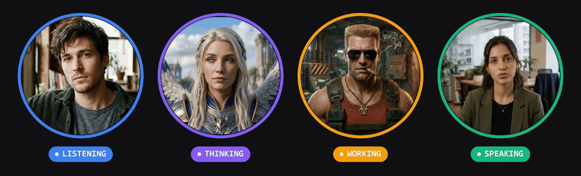
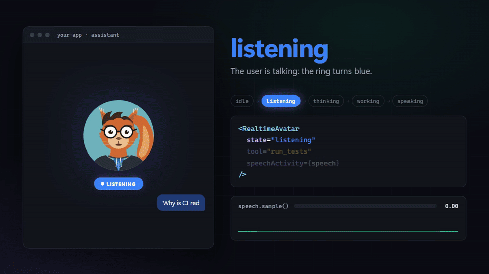
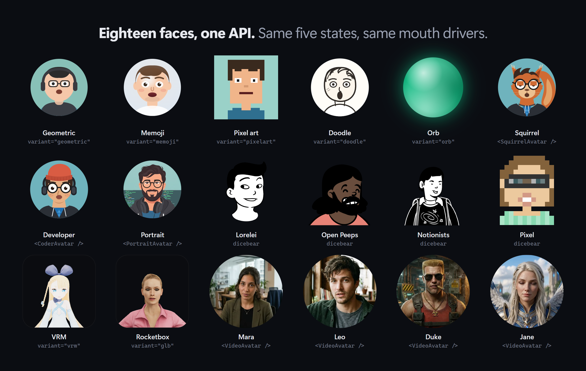

<p align="center">
  <a href="https://react-ai-avatar.vercel.app/">
    
  </a>
</p>

<h1 align="center">react-ai-avatar</h1>

<p align="center">
  <strong>A face for your AI.</strong> The avatar for LLM chat and voice UIs.<br/>
  One React component, no backend. Pass the <code>state</code> you already track,<br/>
  and the face <strong>listens, thinks, calls tools and speaks</strong>.
</p>

<p align="center">
  <a href="https://github.com/aralde/react-ai-avatar/actions/workflows/ci.yml"></a>
  <a href="https://www.npmjs.com/package/react-ai-avatar"></a>
  <a href="https://www.npmjs.com/package/react-ai-avatar"></a>
  <a href="#entry-points-and-bundle-size"></a>
  
  
  <a href="./LICENSE"></a>
</p>

<p align="center">
  <a href="https://react-ai-avatar.vercel.app/"><b>Live demos</b></a> &nbsp;·&nbsp;
  <a href="https://react-ai-avatar.vercel.app/#/docs"><b>Documentation</b></a> &nbsp;·&nbsp;
  <a href="#quickstart"><b>Quickstart</b></a> &nbsp;·&nbsp;
  <a href="#use-it-with-ai-agents"><b>For AI agents</b></a> &nbsp;·&nbsp;
  <a href="https://www.npmjs.com/package/react-ai-avatar"><b>npm</b></a>
</p>

---

It runs entirely in the browser and works with any model: Gemini Live, OpenAI Realtime, a streaming chat endpoint, a local LLM. Your app keeps the microphone, the connection and the provider; the library only draws the face.

<p align="center">
  
</p>

## Why a face

- 🧠 **Users see the model think.** `thinking` gets a thought bubble and an upward gaze, not just a spinner.
- 🛠️ **…and see which tool it's running.** `working` is the state for agents: the pill reads `Working: search_docs`, and a burst of quick tool calls doesn't make the face flicker.
- 👄 **It talks with or without audio.** Pass an `AnalyserNode` for voice, or the token stream of a text-only LLM: the mouth follows either.
- 🎬 **Photoreal or drawn, same API.** Seven kinds of face, from an orb to AI-generated video, all driven by the same five states.
- 📦 **No backend, 17 kB.** It never fetches anything. Three.js and DiceBear are optional and only load if you use them.
- ♿ **Ready for production.** SSR-safe (works with Next.js), respects `prefers-reduced-motion`, announces state changes to screen readers, themable with CSS variables.

## Quickstart

```bash
npm install react-ai-avatar
# or: pnpm add react-ai-avatar · yarn add react-ai-avatar
```

`react` and `react-dom` are the only required peer dependencies. The one prop that matters is `state`: you resolve it in your app, the avatar never infers it.

```tsx
import { RealtimeAvatar } from 'react-ai-avatar';
import 'react-ai-avatar/style.css';

export default function App() {
  // You resolve this in your app (Gemini, OpenAI Realtime, WebRTC, anything)
  const aiState = 'speaking'; // 'idle' | 'listening' | 'thinking' | 'speaking' | 'working'

  return <RealtimeAvatar state={aiState} />;
}
```

> It works? ⭐ [**Star the repo**](https://github.com/aralde/react-ai-avatar). It takes two seconds and helps other React devs find it.

With no `analyser`, `speaking` falls back to a synthetic speech-like mouth, so you can put something on screen before the audio pipeline exists. Pass an `AnalyserNode` to make the mouth react to real audio (see [Driving the mouth](#driving-the-mouth)). Every default is overridable:

```tsx
<RealtimeAvatar
  state={aiState}
  analyser={analyser}                 // AnalyserNode | null: real audio-reactive mouth
  size={300}                          // px or any CSS length ('100%'); default 280
  variant="geometric"                 // 'geometric' | 'memoji' | 'pixelart' | 'doodle' | 'orb' | 'dicebear' | 'vrm' | 'glb' | 'byos'
  customization={{ skinColor: '#f5c7a9', glasses: true }}  // flat presets only; just the keys you change
  stateColors={{ idle: '#4b5563', listening: '#3b82f6', thinking: '#8b5cf6', speaking: '#10b981', working: '#f59e0b' }}
/>
```

For the optional 3D (VRM) variant, also install `three @react-three/fiber @react-three/drei @pixiv/three-vrm`; for `glb`, the same minus `@pixiv/three-vrm`; for `dicebear`, `@dicebear/core @dicebear/collection`. All are **optional** peer dependencies, lazy-loaded only if you use that variant.

## Pick a face

One API, seven kinds of face. Every one reacts to the same five states and the same mouth drivers:

<p align="center">
  
</p>

| Face | What it is | How |
|---|---|---|
| **Video** | a filmed or generated person, one short clip per state | [`<VideoAvatar clips={…} />`](#video-avatars-videoavatar) |
| **Orb** | the glossy sphere voice assistants use, no face | [`variant="orb"`](#the-orb-orb) |
| **Flat presets** | four original SVG looks: geometric, memoji, pixel art, doodle | [`variant="memoji"`](#the-avatar-catalog) |
| **Characters** | branded faces: a developer, a red squirrel, an illustrated portrait | [`react-ai-avatar/characters`](#building-blocks) |
| **DiceBear** | a different face per seed, from a curated CC0 set | [`variant="dicebear"`](#dicebear-avatars-dicebear) |
| **3D** | VRoid/VRM or glTF heads with ARKit blendshapes | [`variant="vrm"` / `"glb"`](#3d-avatars-vrm-and-glb) |
| **Your SVG** | any drawing with five tagged layers | [children of `RealtimeAvatar`](#bring-your-own-svg-byos) |

## Entry points and bundle size

The main entry is the core: `RealtimeAvatar`, `VideoAvatar`, the orb, the four flat presets, the `#rra-*` runtime and the mouth drivers. The rest lives in subpaths, so you only ship what you import:

| Import from | What's there |
|---|---|
| `react-ai-avatar` | the core (above) |
| `react-ai-avatar/characters` | `SquirrelAvatar`, `CoderAvatar`, `PortraitAvatar` |
| `react-ai-avatar/dicebear` | `DiceBearAvatar`, `DiceBearThumb` and the style catalog |
| `react-ai-avatar/3d` | `VrmAvatar`, `GlbArkitAvatar` (also at `react-ai-avatar/vrm`) |

What each import costs your bundle, tree-shaken, minified and gzipped, with React and the optional peers left out ([`scripts/size.mjs`](scripts/size.mjs), checked in CI against the budgets):

<!-- size:start -->
| Import | gzip | budget |
|---|---:|---:|
| `RealtimeAvatar` (core) | 17.0 kB | 18 kB |
| `OrbAvatar` | 1.9 kB | 3 kB |
| `VideoAvatar` | 5.9 kB | 7 kB |
| `createSpeechActivity` only | 0.4 kB | 1 kB |
| `react-ai-avatar/characters` (Squirrel) | 2.9 kB | 4 kB |
| `react-ai-avatar/characters` (Portrait) | 39.8 kB | 42 kB |
| `react-ai-avatar/dicebear` | 3.7 kB | 5 kB |
| `react-ai-avatar/3d` | 3.7 kB | 5 kB |
<!-- size:end -->

`variant="dicebear"`, `"vrm"` and `"glb"` load their renderer as a separate chunk only when they render, so they don't count toward the core.

## Table of contents

- [Pick a face](#pick-a-face)
- [Entry points and bundle size](#entry-points-and-bundle-size)
- [Philosophy](#philosophy)
- [The avatar catalog](#the-avatar-catalog)
- [Driving the mouth](#driving-the-mouth)
- [The orb (`orb`)](#the-orb-orb)
- [Bring your own SVG (`byos`)](#bring-your-own-svg-byos)
- [3D avatars (VRM and GLB)](#3d-avatars-vrm-and-glb)
- [DiceBear avatars (`dicebear`)](#dicebear-avatars-dicebear)
- [Video avatars (`VideoAvatar`)](#video-avatars-videoavatar)
- [Theming](#theming)
- [Use it with AI agents](#use-it-with-ai-agents)
- [API at a glance](#api-at-a-glance)
- [Responsible use](#responsible-use)
- [Positioning](#positioning)
- [Upgrading](#upgrading)
- [Examples](#examples)
- [Community and contributing](#community-and-contributing)
- [License](#license)

## Philosophy

One thing, done well, embeddable in a few lines, no backend, Apache 2.0. The library handles exactly one step of your voice pipeline: turning audio amplitude and state changes into a face that visibly **listens, thinks and speaks**. Your host app keeps the microphone, the WebSocket and the AI provider; none of those dependencies enter your bundle.

## The avatar catalog

| variant | style | notes |
|---|---|---|
| `geometric` | minimal flat geometry | the default; canonical layer-contract example |
| `memoji` | soft volumetric head | radial gradients, glossy eyes, blush |
| `pixelart` | retro 32×32 grid | mouth and pupils move in whole pixels |
| `doodle` | hand-drawn ink sketch | wobbly strokes, sketched thought bubble |
| `orb` | glossy sphere | the voice-assistant look; no face, same states and drivers |
| `dicebear` | [DiceBear](https://www.dicebear.com) styles | optional, lazy-loaded; curated CC0 set; pass `dicebearCollection` / `dicebearSeed` |
| `vrm` | 3D VRoid/VRM model | optional, lazy-loaded; pass `vrmUrl` |
| `glb` | 3D glTF + ARKit blendshapes | optional, lazy-loaded; pass `glbUrl` |
| `byos` | **your** SVG | pass it as children (the variant is then implied); see the layer contract |

All built-in presets are original designs licensed Apache 2.0, like the rest of the package. Keep the LICENSE and NOTICE files when you redistribute them. Want a photoreal face instead of a drawn one? That's its own component: see [Video avatars](#video-avatars-videoavatar).

## Driving the mouth

The mouth has three drivers, in precedence order: a `speechActivity` source, then `streamingText`, then the audio `analyser`. Voice apps use the analyser; text-only LLMs use one of the streaming-text paths. With none, `speaking` plays a synthetic speech-like pattern.

### Audio: an `AnalyserNode`

Route the audio you play through an analyser and pass it in. For the base64 PCM chunks that Gemini Live and OpenAI Realtime return:

```ts
const audioCtx = new AudioContext({ sampleRate: 24000 });
const analyser = audioCtx.createAnalyser(); // <- pass this to <RealtimeAvatar analyser={analyser} />
analyser.fftSize = 256;
analyser.connect(audioCtx.destination);

function playAudioChunk(pcm: Float32Array) {
  const buffer = audioCtx.createBuffer(1, pcm.length, 24000);
  buffer.getChannelData(0).set(pcm);
  const source = audioCtx.createBufferSource();
  source.buffer = buffer;
  source.connect(analyser);
  source.start();
}
```

### Text-streaming LLMs (no audio)

No audio? The mouth follows **token cadence** instead: busy while text arrives, closed on pauses. With a streaming chat hook such as the [Vercel AI SDK](https://sdk.vercel.ai)'s `useChat`, pass the accumulated reply and you're done:

```tsx
import { useChat } from '@ai-sdk/react';
import { RealtimeAvatar } from 'react-ai-avatar';

function ChatAvatar() {
  const { messages, status } = useChat();
  const last = messages.at(-1);

  return (
    <RealtimeAvatar
      state={status === 'submitted' ? 'thinking' : status === 'streaming' ? 'speaking' : 'idle'}
      streamingText={last?.role === 'assistant' ? last.text : ''}
    />
  );
}
```

Reading the stream yourself (`fetch`, or the OpenAI SDK's `for await`)? Create a source with `createSpeechActivity()`, call `speech.push(chunk)` for every chunk and `speech.end()` when the stream finishes, and pass it as `speechActivity`. The [text-streaming guide](https://react-ai-avatar.vercel.app/#/docs/text-streaming) covers both paths and the tuning options, and [`examples/03-streaming-text-imperative.tsx`](examples/03-streaming-text-imperative.tsx) runs end to end against an OpenAI-compatible endpoint, with a tiny relay so the API key never reaches the browser.

## The orb (`orb`)

Many voice apps show an animated sphere instead of a face. Same props, same drivers, same overlays:

```tsx
<RealtimeAvatar variant="orb" state={aiState} analyser={analyser} />
```

Idle, it breathes slowly; listening, it reacts to the audio; thinking, it swirls faster; working, a ring spins around it; speaking, it swells with the voice. The state color tints it (`stateColors`). Under `prefers-reduced-motion` it holds still and only changes color. Want just the sphere, without the pill and bubbles? Use `<OrbAvatar state={aiState} analyser={analyser} />`.

## Bring your own SVG (`byos`)

Any SVG exposing these stable hooks is animated by the runtime — same blink, gaze, mouth and thinking behavior as the built-in presets:

| hook | part | the runtime drives |
|---|---|---|
| `#rra-ring` | state ring | `stroke` = `stateColors[state]` |
| `#rra-mouth` | mouth | ellipse: `ry`/`rx` · rect: `height` |
| `.rra-pupil` (×2) | pupils | circle: `cx`/`cy` · rect: `x`/`y` (mouse tracking, thinking gaze) |
| `.rra-lid` (×2) | eyelids | `height` (blink; 0 = open) |
| `#rra-think` | thought bubble | `opacity` + dots pulsing while `thinking` |

Optional data attributes: `data-base-x`/`data-base-y` (pupil rest position), `data-max-height` (closed lid height), `data-quantize` (snap motion to a grid — that's how the pixel-art preset stays chunky).

```tsx
<RealtimeAvatar state={aiState} analyser={analyser}>
  <MyOwnSvgAvatar /> {/* exposes the #rra-* hooks; its license is your business */}
</RealtimeAvatar>
```

Passing children implies `variant="byos"`. Pass `state` once, to `RealtimeAvatar`: a face that needs it for its own poses reads it with `useAvatarState()`, and the shipped characters already do:

```tsx
import { SquirrelAvatar } from 'react-ai-avatar/characters';

<RealtimeAvatar state={aiState}>
  <SquirrelAvatar poses /> {/* follows aiState: hand on chin while thinking, etc. */}
</RealtimeAvatar>
```

```tsx
import { useAvatarState } from 'react-ai-avatar';

function MyOwnSvgAvatar() {
  const state = useAvatarState(); // the enclosing avatar's state
  return <svg viewBox="0 0 200 200">{/* … #rra-* hooks, plus a prop for 'working' */}</svg>;
}
```

## 3D avatars (VRM and GLB)

Both 3D variants share the same mouth engine as the flat presets, so the model talks, blinks and follows the cursor. The three.js stack is an **optional** peer dependency, lazy-loaded only when one of these variants renders.

```bash
npm install three @react-three/fiber @react-three/drei @pixiv/three-vrm   # for glb, leave out @pixiv/three-vrm
```

```tsx
<RealtimeAvatar state={aiState} analyser={analyser} variant="vrm" vrmUrl="/models/avatar.vrm" />
<RealtimeAvatar state={aiState} analyser={analyser} variant="glb" glbUrl="/models/rocketbox.glb" />
```

`vrm` renders VRoid/VRM models with visemes and gaze tracking. `glb` renders any `.glb` that exposes the **52 [ARKit blendshapes](https://arkit-face-blendshapes.com/)**: [Microsoft Rocketbox](https://github.com/microsoft/Microsoft-Rocketbox) avatars (MIT; convert the `.fbx` to `.glb` once, keeping the blendshapes) and [Ready Player Me](https://docs.readyplayer.me/ready-player-me/api-reference/avatars/morph-targets/apple-arkit) avatars work out of the box. To render a model outside `RealtimeAvatar`, import `VrmAvatar` or `GlbArkitAvatar` from `react-ai-avatar/3d`. More in the [3D guide](https://react-ai-avatar.vercel.app/#/docs/3d).

## DiceBear avatars (`dicebear`)

Generate [DiceBear](https://www.dicebear.com) avatars client-side: deterministic per `seed`, no network call. The packages are **optional** peer dependencies, lazy-loaded only when this variant renders:

```bash
npm install @dicebear/core @dicebear/collection
```

```tsx
<RealtimeAvatar
  state={aiState}
  analyser={analyser}
  variant="dicebear"
  dicebearCollection="open-peeps" // curated CC0 style id
  dicebearSeed="ada-lovelace"     // same seed + style => same face
/>
```

The catalog (`DICEBEAR_STYLES`) is curated to **CC0 1.0** styles that have a face, so it keeps the no-attribution promise. Any other style id works too, but its license becomes your responsibility. Every curated style actually **talks**: the avatar pre-renders a few frames of the same face with closed, mid and open mouths (and a blink where the style allows) and swaps them with the audio. For the standalone `DiceBearAvatar` / `DiceBearThumb`, import from `react-ai-avatar/dicebear`.

## Video avatars (`VideoAvatar`)

Instead of drawing a face, play footage: one short looping clip per state, crossfaded when `state` changes. The package ships **no** footage: you pass the URLs. A photoreal face is the one that most needs an "AI" label and the rights to the likeness: see [Responsible use](#responsible-use).

```tsx
import { VideoAvatar, type VideoClips, type IdleVariation } from 'react-ai-avatar';

const clip = (name: string) => ({ webm: `/clips/${name}.webm`, mp4: `/clips/${name}.mp4` });

// Module constants (or useMemo): a new array identity restarts the idle timer.
const CLIPS: VideoClips = {
  idle: clip('idle'),           // required
  listening: clip('listening'), // every other state is optional:
  thinking: clip('thinking'),   //   working → thinking → idle, the rest → idle
  working: clip('working'),
  speaking: clip('speaking'),
};
const IDLE_VARIATIONS: IdleVariation[] = [
  { clip: clip('idle-stretch'), cooldownMs: 60_000 },
  { clip: clip('idle-coffee'), afterIdleMs: 90_000, cooldownMs: 300_000 },
];

<VideoAvatar
  clips={CLIPS}
  state={aiState}
  speechActivity={speech}       // or analyser={analyser}
  idleVariations={IDLE_VARIATIONS}
  poster="/clips/poster.jpg"
  size={320}
  style={{ borderRadius: '50%' }}
/>
```

What it does for you:

- **Speech-gated talking.** With `speechActivity` or `analyser`, the speaking clip shows only while there's speech; after ~0.7 s of silence it falls back to idle and resumes when speech does.
- **Idle variations.** One-shot clips now and then while idle, each with its own `afterIdleMs` (the coffee only after a long wait) and `cooldownMs`.
- **No flicker on tool bursts.** An agent loop flips `thinking ↔ working` on every tool call; `minHoldMs` and `busySettleMs` keep the face still, and only a long-running tool shows `working`.
- **Seamless cuts.** Clips crossfade and resume where they paused. `prefers-reduced-motion` holds a still frame.
- **The same overlays as `RealtimeAvatar`**: state pill, bubbles, subtitles and glow, each one switchable off.

**Make your own clips in an afternoon.** Generate one neutral portrait, then five short clips that start and end on it, with any text-to-video model (the [step-by-step guide](https://react-ai-avatar.vercel.app/#/docs/video-avatar) uses Google Flow and has the five prompts). Then turn each into a square, silent, seamless loop with [`scripts/prepare-video-clips.ts`](scripts/prepare-video-clips.ts) (needs `ffmpeg`):

```bash
node --experimental-strip-types scripts/prepare-video-clips.ts raw/idle.mp4 --name idle --out public/clips --poster
node --experimental-strip-types scripts/prepare-video-clips.ts raw/coffee.mp4 --name idle-coffee --mode once --out public/clips
```

`--mode loop` (default) plays the clip forward and then back; `--mode xfade` always plays forward and dissolves the end into the start, for footage where reversed motion shows (smoke, hair); `--mode once` is for idle variations. `--from` / `--to` keep only the usable part.

**Limits, honestly:** the mouth isn't synced to the words; speaking is gated on and off by speech energy. Clips are muted (so they can autoplay) and loaded up front: seven 512 px clips are about 3 MB as WebM. See [`examples/12-video-avatar.tsx`](examples/12-video-avatar.tsx).

## Theming

The face takes `stateColors` (ring, glow, pill and orb per state) and, for the flat presets, `customization`. Everything around the face reads CSS variables, so you can match your design system without touching the layout. Set them on `:root`, your app shell, or one avatar's `style`; the defaults are the dark look you see in the demos.

```css
:root {
  --rra-bubble-bg: #ffffff;        /* thought and emoji bubbles */
  --rra-bubble-fg: #1f2937;        /* thought text */
  --rra-bubble-border: #0d9488;    /* bubble outline */
  --rra-bubble-accent: #0d9488;    /* "Thought process" label */
  --rra-caption-bg: #ffffff;       /* subtitles */
  --rra-caption-fg: #111827;
  --rra-caption-border: #d1d5db;
  --rra-caption-shadow: none;      /* the default text-shadow suits dark backgrounds */
  --rra-pill-fg: #ffffff;          /* state pill text; its fill is the state color */
}
```

The overlays keep stable hook classes (`rra-avatar`, `rra-state-pill`, `rra-glow`, `rra-bubble`, `rra-caption-box`), and the root carries `data-state`, so you can go further in plain CSS: `.rra-avatar[data-state='thinking'] .rra-state-pill { … }`. For a fully custom HUD, turn the overlays off (`showStatePill={false}`, …) and render your own, or the in-flow `<AvatarCaption>` / `<AvatarThought>` widgets, next to the avatar.

## Use it with AI agents

Want your own character instead of a preset? This repo ships an [Agent Skill](https://docs.claude.com/en/docs/agents-and-tools/agent-skills/overview) (a folder of instructions an AI coding agent loads when the task matches) that teaches the agent the `#rra-*` layer contract. Add it to your project:

```bash
npx degit aralde/react-ai-avatar/.claude/skills/rra-character-avatar .claude/skills/rra-character-avatar
```

Then ask your agent for a face, for example: *"Make a react-ai-avatar character of a friendly robot with a visor, in our brand colors"*. It draws the SVG with the tagged layers, so the runtime makes it blink, look around, talk and think, and it checks the result in a standalone preview page. It works with Claude Code out of the box and with any agent that reads `SKILL.md` skills.

## API at a glance

The props you'll use most. The [full API reference](https://react-ai-avatar.vercel.app/#/docs/api) lists every prop and export.

| `<RealtimeAvatar />` prop | What it does |
|---|---|
| `state` | `'idle'`, `'listening'`, `'thinking'`, `'speaking'` or `'working'`. You resolve it; it's never inferred. |
| `tool` | while `working`, the pill reads `Working: {tool}` |
| `analyser` / `streamingText` / `speechActivity` | the mouth drivers: audio, accumulated text, or token cadence (each one overrides the previous) |
| `variant` / `children` | which face; children imply `byos` and inherit `state` |
| `size` | px or any CSS length; default `280` |
| `subtitle` / `thought` / `thinkingEmojis` | captions, a thought bubble, or an emoji reel while thinking |
| `stateColors` / `stateLabels` / `customization` | theming; labels are announced to screen readers |
| `showGlow` / `showStatePill` / `showThought` / `showSubtitle` | turn each overlay off |

`<VideoAvatar />` takes the same overlay props and mouth drivers, plus `clips`, `idleVariations`, `idleVariationIntervalMs`, `minHoldMs`, `busySettleMs`, `crossfadeMs` and `poster`.

### Building blocks

Everything the runtime uses is exported, so you can compose your own: `ContractAvatar`, `useAvatarRuntime`, `createMouthEngine`, `createSpeechActivity`, `useStreamingTextActivity`, `useAvatarState`, `useReducedMotion`, the raw presets and `OrbAvatar`, plus in-flow `AvatarCaption` / `AvatarThought` widgets for your own layout. From `react-ai-avatar/characters`: `SquirrelAvatar`, `CoderAvatar` and `PortraitAvatar`, three branded faces on the same contract, with optional per-state poses (`poses`). Details in the [API reference](https://react-ai-avatar.vercel.app/#/docs/api).

## Responsible use

A face makes an assistant feel like someone. Some care keeps that honest:

- **Say it's an AI.** Label the assistant as AI-generated wherever it appears, especially with `VideoAvatar` or any photoreal face. Several jurisdictions now require it for synthetic content that resembles a real person (the EU AI Act's transparency rules, for one).
- **Use faces you have the rights to.** Footage of a real person needs their consent for this use; a generated person should not imitate a real one. Check the terms of the video model you generate clips with.
- **Don't let the face promise more than the model.** A calm, confident face over a wrong answer still misleads. Show `thinking` and `working` honestly, and keep errors visible.
- **Respect motion preferences.** Every face already honors `prefers-reduced-motion`; don't override it.

The library ships no footage and no likeness of anyone but the author's own portrait.

## Positioning

The closest reference is [TalkingHead](https://github.com/met4citizen/TalkingHead) (3D, realistic lip-sync, Ready Player Me/Mixamo rigs). This library makes the opposite bet:

| | TalkingHead & co. | react-ai-avatar |
|---|---|---|
| Star of the show | the realistic human avatar | the LLM's speech + **state** flow |
| Avatar | 3D full-body rigged | flat SVG, minimal (3D optional, not the focus) |
| Technical focus | lip-sync fidelity | state + audio reactivity, simplicity |
| Makes visible | the voice | the *thinking* |
| Setup | avatar platform + Blender + rig | `npm i` + one component |

For a photoreal face, `VideoAvatar` sits between a drawn face and the neural talking-head services (HeyGen, D-ID, Tavus, Simli). Those render real lip-sync server-side per conversation, are paid per minute, and add a streaming backend; `VideoAvatar` plays pre-made clips entirely in the browser, free and backend-less, at the cost of gated rather than synced lips.

## Upgrading

0.7 types props per `variant` (TypeScript now rejects a prop the variant ignores) and prefixes the stylesheet; 0.6 moved characters and DiceBear to subpaths and dropped `motion`. The [migration guide](https://react-ai-avatar.vercel.app/#/docs/migrating) has the fixes, and the [CHANGELOG](CHANGELOG.md) has everything else.

## Examples

Copy-pasteable, single-file integration examples, including a reference relay server for real voice and text providers, live in [`examples/`](examples/): quickstart, `useChat`, imperative streaming, audio analyser, the catalog, `byos`, Gemini Live voice, branded characters and a video avatar. The runnable versions (client-side mock, no API key) are on the [docs site](https://react-ai-avatar.vercel.app/).

## Community and contributing

- **Questions, ideas, show-and-tell:** [GitHub Discussions](https://github.com/aralde/react-ai-avatar/discussions).
- **Bugs and feature requests:** [Issues](https://github.com/aralde/react-ai-avatar/issues).
- **Pull requests** are welcome, especially new faces on the `#rra-*` contract and integration examples. [CONTRIBUTING.md](CONTRIBUTING.md) has the setup and the few rules.

## License

Apache License 2.0, for the library, the runtime and all built-in presets. Use it commercially, fork it, reskin it; keep the [LICENSE](LICENSE) and [NOTICE](NOTICE) files when you redistribute. SVGs you bring via `byos` keep whatever license they had.
